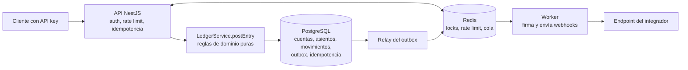

Read in English: [README.md](README.md)

# Austral Ledger

[](https://github.com/JPozoAravena/austral-ledger/actions/workflows/ci.yml)
[](https://github.com/JPozoAravena/austral-ledger/actions/workflows/codeql.yml)
[](https://sonarcloud.io/summary/new_code?id=JPozoAravena_austral-ledger)
[](https://sonarcloud.io/summary/new_code?id=JPozoAravena_austral-ledger)

API de ledger de billeteras con partida doble para Monedero Austral SpA, una fintech ficticia que paga a
repartidores y trabajadores de plataformas. Los usuarios tienen billeteras, las plataformas las fondean y
los pagos salen del sistema. Cada peso es trazable a un asiento balanceado.

**[Referencia de la API (OpenAPI)](https://jpozoaravena.github.io/austral-ledger/)** · [Arquitectura](#arquitectura) · [ADRs](docs/adr)

> Proyecto de portafolio. Empresa y datos ficticios. Corre en local con Docker Compose, costo cero.

## Puntos destacados

Enfocado en la correctitud de los movimientos de dinero, la concurrencia y la seguridad.

| Desafío                                    | Cómo se resuelve                                                                                                                                                                                                       |
| ------------------------------------------ | ---------------------------------------------------------------------------------------------------------------------------------------------------------------------------------------------------------------------- |
| El dinero no puede aparecer ni desaparecer | Partida doble: cada asiento suma 0 y tiene al menos 2 movimientos, validado por un trigger de restricción diferido en PostgreSQL, no solo en el código ([ADR 0001](docs/adr/0001-double-entry-immutable-postings.md)). |
| El historial no se reescribe               | Los movimientos son inmutables (triggers bloquean UPDATE, DELETE y TRUNCATE). Los errores se corrigen con asientos compensatorios (`POST /v1/entries/:id/reverse`).                                                    |
| Reintentos tras un timeout                 | `Idempotency-Key`: lock en Redis por velocidad, restricción única en PostgreSQL como verdad final, en la misma transacción que el movimiento ([ADR 0002](docs/adr/0002-idempotency-redis-lock-postgres-truth.md)).     |
| Transferencias concurrentes                | `SELECT ... FOR UPDATE` ordenado por id de cuenta (sin deadlocks), política de saldo verificada antes de escribir ([ADR 0003](docs/adr/0003-concurrency-ordered-row-locks.md)).                                        |
| Avisar a integradores de forma confiable   | Outbox transaccional, worker BullMQ, webhooks firmados con HMAC con reintentos y backoff ([ADR 0004](docs/adr/0004-transactional-outbox-webhooks.md)).                                                                 |
| Un cliente leyendo datos de otro           | API keys con hash, scopes y una política por objeto; sin acceso responde 404, nunca 403 ([ADR 0005](docs/adr/0005-hashed-api-keys-and-bola-policy.md)).                                                                |
| Dinero y números                           | `BIGINT` en pesos chilenos enteros de punta a punta. Los montos viajan como strings en JSON.                                                                                                                           |
| Auditoría y conciliación                   | Reportes de balance de comprobación y conciliación agregados con `GROUP BY` en SQL.                                                                                                                                    |

## Arquitectura



- **API** (`src/main.ts`): HTTP, auth, validación, idempotencia, rate limit, OpenAPI en `/docs`.
- **Dominio** (`src/domain`): lógica pura sin Nest, se prueba con unit tests sin base de datos.
- **Worker** (`src/worker.ts`): proceso aparte que entrega los webhooks; la API nunca lo ejecuta.
- Las capas dependen en un solo sentido: presentación, aplicación, dominio, infraestructura.

<details>
<summary>Decisiones de diseño</summary>

Registradas como ADRs en [`docs/adr`](docs/adr) (en inglés):

- [0001](docs/adr/0001-double-entry-immutable-postings.md) Partida doble con movimientos inmutables e invariantes en la base de datos.
- [0002](docs/adr/0002-idempotency-redis-lock-postgres-truth.md) Idempotencia: lock en Redis, PostgreSQL como verdad.
- [0003](docs/adr/0003-concurrency-ordered-row-locks.md) Concurrencia con locks de fila ordenados.
- [0004](docs/adr/0004-transactional-outbox-webhooks.md) Outbox transaccional para webhooks.
- [0005](docs/adr/0005-hashed-api-keys-and-bola-policy.md) API keys con hash, scopes y política BOLA.

Otras decisiones:

- Convención de signo: débito positivo, crédito negativo. `accounts.balance` es el saldo natural.
- `USER_WALLET` nunca queda en negativo (`INSUFFICIENT_FUNDS`).
- Los errores son `{ error: { code, message } }`; los cuerpos se validan con zod y `/docs` se genera desde los mismos esquemas.

</details>

## Stack

| Capa            | Herramientas                                                                              |
| --------------- | ----------------------------------------------------------------------------------------- |
| API             | NestJS 12 (ESM), TypeScript estricto, zod, pino                                           |
| Datos           | PostgreSQL + Drizzle ORM, Redis, BullMQ                                                   |
| Testing         | Vitest, Testcontainers, Supertest, k6 (carga)                                             |
| CI/CD y calidad | GitHub Actions, SonarQube Cloud (sin secretos vía GitHub OIDC), CodeQL, Trivy, Dependabot |
| Infra           | Docker Compose, Terraform (provider Docker), Node 26                                      |

## Seguridad

- **Autenticación:** las API keys se guardan solo como HMAC-SHA256 con pepper, se buscan por prefijo y se comparan con `timingSafeEqual`.
- **Autorización:** scopes por endpoint (lo no declarado se rechaza) más una política por objeto contra BOLA.
- **Abuso:** rate limit en Redis por key o IP, más estricto para POST; entradas validadas en el borde con zod; solo consultas parametrizadas.
- **Webhooks:** firmas HMAC-SHA256, secretos cifrados con AES-256-GCM, protección SSRF al registrar y en cada envío.
- **Cadena de suministro:** dependencias con versión exacta, Dependabot, CodeQL, escaneos Trivy de filesystem e imagen, SonarQube sin secretos vía OIDC.
- **Secretos:** ninguno en el código; `.env` se ignora y `.env.example` documenta cada variable.

## Prácticas de ingeniería

- **Tests:** unitarios para el dominio, de integración contra PostgreSQL y Redis reales con Testcontainers, y pruebas de carga con k6 (`load/k6`).
- **CI:** lint sin warnings, typecheck, tests con cobertura, validación de Terraform y luego el quality gate de SonarQube.
- **Flujo:** una rama y PR por fase, Conventional Commits.
- **Decisiones:** decisiones de arquitectura registradas como ADRs.

<details>
<summary>Ejecutar en local</summary>

Requisitos: Node 26 (`.nvmrc`), Docker.

```bash
cp .env.example .env          # luego define API_KEY_PEPPER y WEBHOOK_SECRET_KEY (ver comentarios del archivo)
docker compose up --build     # postgres, redis, api (puerto 3000) y worker
npm ci
npm run db:migrate            # aplica las migraciones usando DATABASE_URL
npm run seed                  # crea las 4 cuentas del sistema e imprime una API key ops una sola vez
```

Luego abre `http://localhost:3000/docs` y autoriza con la key impresa (`Authorization: Bearer ...`).
Crea más keys con `npm run apikey:create`. Alternativa con Terraform: ver [`infra/terraform`](infra/terraform/README.md).

</details>

<details>
<summary>Tests</summary>

```bash
npm run lint
npm run typecheck
npm test                  # unit + e2e (sin Docker)
npm run test:integration  # Testcontainers, requiere Docker corriendo
npm run test:cov          # todo, con cobertura
```

Prueba de carga: ver [`load/k6/transfers.js`](load/k6/transfers.js). El CI ejecuta lint, typecheck y `test:cov`, y luego SonarQube.

</details>

## Desarrollo asistido por IA

Construido con Claude Code bajo reglas escritas (`CLAUDE.md`) y revisión humana de cada decisión. Qué
hizo la IA, qué decidió la persona y qué se corrigió está en [`docs/ai-usage.md`](docs/ai-usage.md) (en inglés).

<details>
<summary>Limitaciones conocidas y roadmap</summary>

- **Los webhooks son at-least-once.** Quien los recibe debe deduplicar por id de evento.
- **El lock de Redis y el rate limit fallan abiertos.** Si Redis cae, la correctitud se mantiene (PostgreSQL es la verdad), pero el rate limit deja de funcionar.
- **Serialización por cuenta.** Las cuentas calientes (como la de fondeo) limitan el throughput; no hay sharding.
- **Una sola moneda (CLP), sin FX ni motor de comisiones.**
- **Solo despliegue local.** Docker Compose y Terraform apuntan a un daemon local, no a una nube.
- **Solo API keys.** Sin OAuth, sin sesiones de usuario y sin endpoint de rotación de keys todavía.

Roadmap:

- Endpoint de rotación y expiración de keys.
- Paginación por cursor en reportes y asientos.
- Destino de despliegue en la nube.

</details>

## Autor

**Juan Pozo Aravena**, Ingeniero de Software de Chile, abierto a trabajo remoto.
[LinkedIn](#) <!-- TODO: URL de LinkedIn --> · [GitHub](https://github.com/JPozoAravena)
