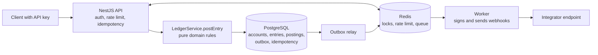

Leer en español: [README.es.md](README.es.md)

# Austral Ledger

[](https://github.com/JPozoAravena/austral-ledger/actions/workflows/ci.yml)
[](https://github.com/JPozoAravena/austral-ledger/actions/workflows/codeql.yml)
[](https://sonarcloud.io/summary/new_code?id=JPozoAravena_austral-ledger)
[](https://sonarcloud.io/summary/new_code?id=JPozoAravena_austral-ledger)

Double-entry wallet ledger API for Monedero Austral SpA, a fictional fintech that pays delivery riders and
platform workers. Users hold wallets, platforms fund them, and payouts leave the system. Every peso is
traceable to a balanced entry.

**[API reference (OpenAPI)](https://jpozoaravena.github.io/austral-ledger/)** · [Architecture](#architecture) · [ADRs](docs/adr)

> Portfolio project. Fictional company and data. Runs locally with Docker Compose, zero cost.

## Highlights

Focused on correctness of money movements, concurrency and security.

| Challenge | How it's solved |
| --- | --- |
| Money must never appear or vanish | Double-entry: every entry sums to 0 with at least 2 postings, enforced by a deferred constraint trigger in PostgreSQL, not only in code ([ADR 0001](docs/adr/0001-double-entry-immutable-postings.md)). |
| History must not be rewritten | Postings are immutable (triggers block UPDATE, DELETE, TRUNCATE). Mistakes are fixed with compensating entries (`POST /v1/entries/:id/reverse`). |
| Retries after a timeout | `Idempotency-Key`: Redis lock for speed, PostgreSQL unique constraint as the final truth, in the same transaction as the money movement ([ADR 0002](docs/adr/0002-idempotency-redis-lock-postgres-truth.md)). |
| Concurrent transfers | `SELECT ... FOR UPDATE` ordered by account id (no deadlocks), balance policy checked before writing ([ADR 0003](docs/adr/0003-concurrency-ordered-row-locks.md)). |
| Notifying integrators reliably | Transactional outbox, BullMQ worker, HMAC-signed webhooks with retries and backoff ([ADR 0004](docs/adr/0004-transactional-outbox-webhooks.md)). |
| One tenant reading another's data | Hashed API keys with scopes and an object-level policy; no access answers 404, never 403 ([ADR 0005](docs/adr/0005-hashed-api-keys-and-bola-policy.md)). |
| Money and numbers | `BIGINT` integer CLP end to end. Amounts travel as strings in JSON. |
| Audit and reconciliation | Trial balance and reconciliation reports aggregated with `GROUP BY` in SQL. |

## Architecture



- **API** (`src/main.ts`): HTTP, auth, validation, idempotency, rate limit, OpenAPI at `/docs`.
- **Domain** (`src/domain`): pure logic with no Nest, so it is unit-tested without a database.
- **Worker** (`src/worker.ts`): separate process that delivers webhooks; the API never runs it.
- Layers depend in one direction only: presentation, application, domain, infrastructure.

<details>
<summary>Design decisions</summary>

Recorded as ADRs in [`docs/adr`](docs/adr):

- [0001](docs/adr/0001-double-entry-immutable-postings.md) Double-entry with immutable postings and database-enforced invariants.
- [0002](docs/adr/0002-idempotency-redis-lock-postgres-truth.md) Idempotency: Redis lock, PostgreSQL as the truth.
- [0003](docs/adr/0003-concurrency-ordered-row-locks.md) Concurrency with ordered row locks.
- [0004](docs/adr/0004-transactional-outbox-webhooks.md) Transactional outbox for webhooks.
- [0005](docs/adr/0005-hashed-api-keys-and-bola-policy.md) Hashed API keys, scopes and BOLA policy.

Other choices:

- Sign convention: debit is positive, credit is negative. `accounts.balance` is the natural balance.
- `USER_WALLET` can never go negative (`INSUFFICIENT_FUNDS`).
- Errors are `{ error: { code, message } }`; request bodies are validated with zod, and `/docs` is generated from the same schemas.

</details>

## Tech stack

| Layer | Tools |
| --- | --- |
| API | NestJS 12 (ESM), strict TypeScript, zod, pino |
| Data | PostgreSQL + Drizzle ORM, Redis, BullMQ |
| Testing | Vitest, Testcontainers, Supertest, k6 (load) |
| CI/CD & Quality | GitHub Actions, SonarQube Cloud (secretless via GitHub OIDC), CodeQL, Trivy, Dependabot |
| Infra | Docker Compose, Terraform (Docker provider), Node 26 |

## Security

- **Authentication:** API keys stored only as HMAC-SHA256 with a pepper, looked up by prefix, compared with `timingSafeEqual`.
- **Authorization:** scopes per endpoint (anything undeclared is rejected) plus an object-level policy against BOLA.
- **Abuse:** Redis rate limit per key or IP, stricter for POST; inputs validated at the boundary with zod; parameterized queries only.
- **Webhooks:** HMAC-SHA256 signatures, secrets encrypted with AES-256-GCM, SSRF protection checked at registration and on every send.
- **Supply chain:** exact dependency versions, Dependabot, CodeQL, Trivy filesystem and image scans, secretless SonarQube via OIDC.
- **Secrets:** none in code; `.env` is ignored and `.env.example` documents every variable.

## Engineering practices

- **Tests:** unit tests for domain logic, integration tests against real PostgreSQL and Redis with Testcontainers, and k6 load tests (`load/k6`).
- **CI:** lint with zero warnings, typecheck, tests with coverage, Terraform validation, then the SonarQube quality gate.
- **Workflow:** one branch and PR per phase, Conventional Commits.
- **Decisions:** architecture decisions recorded as ADRs.

<details>
<summary>Run locally</summary>

Requirements: Node 26 (`.nvmrc`), Docker.

```bash
cp .env.example .env          # then set API_KEY_PEPPER and WEBHOOK_SECRET_KEY (see comments in the file)
docker compose up --build     # postgres, redis, api (port 3000) and worker
npm ci
npm run db:migrate            # applies migrations using DATABASE_URL
npm run seed                  # creates the 4 system accounts and prints an ops API key once
```

Then open `http://localhost:3000/docs` and authorize with the printed key (`Authorization: Bearer ...`).
Create more keys with `npm run apikey:create`. Terraform alternative: see [`infra/terraform`](infra/terraform/README.md).

</details>

<details>
<summary>Tests</summary>

```bash
npm run lint
npm run typecheck
npm test                  # unit + e2e (no Docker)
npm run test:integration  # Testcontainers, needs Docker running
npm run test:cov          # everything, with coverage
```

Load test: see [`load/k6/transfers.js`](load/k6/transfers.js). CI runs lint, typecheck and `test:cov`, then SonarQube.

</details>

## AI-assisted development

Built with Claude Code under written rules (`CLAUDE.md`) and human review of every decision. What the
AI did, what the human decided and what was corrected is in [`docs/ai-usage.md`](docs/ai-usage.md).

<details>
<summary>Known limitations and roadmap</summary>

- **Webhooks are at-least-once.** Receivers must deduplicate by event id.
- **Redis lock and rate limit fail open.** If Redis is down, correctness still holds (PostgreSQL is the truth), but rate limiting stops.
- **Per-account serialization.** Hot accounts (such as the funding account) limit throughput; there is no sharding.
- **Single currency (CLP), no FX, no fees engine.**
- **Local deployment only.** Docker Compose and Terraform target a local daemon, not a cloud.
- **API keys only.** No OAuth, no user sessions, no key-rotation endpoint yet.

Roadmap:

- Key rotation endpoint and expiry.
- Cursor pagination on reports and entries.
- Cloud deployment target.

</details>

## Author

**Juan Pozo Aravena**, Software Engineer from Chile, open to remote.
[LinkedIn](#) <!-- TODO: LinkedIn URL --> · [GitHub](https://github.com/JPozoAravena)
